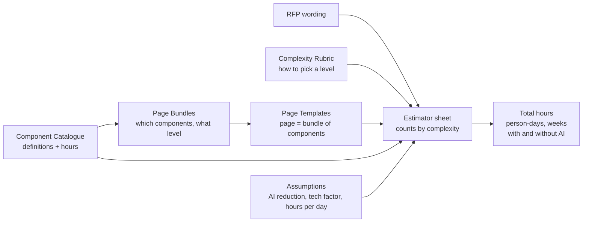

# UI / UX Build Effort Estimator
### Team presentation and live demo

Workbook: `UI_UX_Effort_Estimator.xlsx` (Draft v0.1)

---

## Part 1 - What we are presenting

### 1.1 Why we are here

- RFPs ask for a UI/UX build estimate, and today every estimator answers differently.
- The team agreed to build a **generic, repeatable** way to estimate developer effort.
- Requirements from the earlier call:
  - Break the work into components, each rated **Simple / Medium / Complex**.
  - Define clearly what Simple, Medium and Complex mean.
  - Attach **hours** to each level, based on the team's experience.
  - Make it **generic**: any Kyndryl developer should be able to deliver the work in the stated hours, so nothing is person-specific.
  - Scope is **developer effort**: development plus unit testing.
  - Optionally extend to agent development later.

### 1.2 What we built

A single Excel workbook that turns an RFP's wording ("1 login page, 3 analytics dashboards, 4 admin pages, 5 APIs...") into a total effort in hours, person-days and weeks.

It was built from the requirements discussed on the call, and its main features are:

| Feature | Why it matters |
|---|---|
| A written **Complexity Rubric** and a **Complexity Advisor** | Two people reading the same RFP choose the same level, and the Advisor shows the reasoning |
| **Backend APIs** as first-class items | UI work is never estimated without the APIs behind it |
| **Page Templates** built from components, with a **Page Explorer** | Estimators start from "a dashboard page", not from 60 loose components, and can see exactly what is inside every page |
| **Summary & Scenarios** sheet | A one-page view for sales and clients, with the top hour drivers and a baseline versus AI versus what-if comparison |

### 1.3 Who uses it

| Persona | What they do in the workbook |
|---|---|
| RFP / bid responder (architect, tech lead) | Converts RFP text into page, component and API counts on the **Estimator** sheet |
| Sales / pricing team | Reads the summary: total hours, person-days, duration |
| Reviewers / leadership | Check the **Complexity Rubric** and **Component Catalogue** for sensible definitions and hours |
| UI and back-end developers | Maintain the hours in the **Component Catalogue** and **Page Bundles** from their own experience |

### 1.4 What is in scope

| Included | Excluded |
|---|---|
| Developer build effort | UAT and integration testing |
| Unit tests | Project management |
| Modern web apps (Next.js / React baseline) | Requirements gathering |
| The API layer behind the UI | DevOps, database design, data pipelines |
| | Agent / RAG development (only the UI and API layer that talk to agents are covered) |

This matches what was agreed on the earlier call.

---

## Part 2 - How it works

### 2.1 The big picture

The key idea: **hours live in exactly one place** (the Component Catalogue). Pages are built from components, so changing one component's hours updates every page that uses it. Nothing is hard-coded.

### 2.2 The sheets, in the order we will visit them

| # | Sheet | What it is | Who edits it |
|---|---|---|---|
| 1 | **Read Me** | Purpose, personas, scope, 5-step instructions, colour guide | Nobody |
| 2 | **Estimator** | The working sheet: inputs and the summary | Estimator |
| 3 | **Summary** | One-page view: headline, where the hours go, top page drivers, scenarios | Calculated (only the what-if cells are inputs) |
| 4 | **Complexity Advisor** | Answer 7 questions, get a recommended level with the reason and hours | Estimator |
| 5 | **Complexity Rubric** | Rules for choosing Simple / Medium / Complex | Reviewers |
| 6 | **Component Catalogue** | 63 components with definitions and hours per level | Developers |
| 7 | **Page Templates** | 11 page types with definitions and hours per level | Calculated |
| 8 | **Page Bundles** | The recipe: which components make up each page | Developers |
| 9 | **Assumptions** | AI reduction, technology factor, hours per day / week, baseline assumptions | Team |

### 2.3 Colour guide

- Blue text on yellow = **input** (the only cells you type in)
- Navy = headers
- Green / amber / red headers = Simple / Medium / Complex

### 2.4 The three inputs on the Estimator

| Section | What you enter | Example |
|---|---|---|
| **A. UI pages** | How many Simple / Medium / Complex pages, for each of 11 page types | Dashboard: 0 Simple, 2 Medium, 1 Complex |
| **B. Shared components** | Pick a component from a dropdown, choose a level, enter a quantity | App shell, Medium, 1 |
| **C. Backend APIs** | How many Simple / Medium / Complex endpoints, per API type | CRUD endpoint: 6 Medium |

### 2.5 The 11 page types

Login & authentication, Dashboard / analytics, List / search, Detail / record, Form / data-entry, Wizard / guided workflow, Admin / configuration, AI chat assistant, Agent / workflow monitor, Report & export, Content / landing.

Each has a written definition for Simple, Medium and Complex, plus the typical APIs it needs.

### 2.6 The component catalogue (63 components)

Foundation & Layout, Data Display, Forms & Inputs, Search & Filter, Charts & Dashboards, Overlays & Feedback, AI & Conversational UI, Files & Reporting, Auth & Access, Admin & Enterprise, and **Backend API** (10 API types).

Every component has a unit (for example "per page" or "per application"), a one-line definition for each level, and hours for each level.

Example: **Data table**: Simple 4 h, Medium 12 h, Complex 24 h.

### 2.7 How the complexity rubric works

- Seven dimensions are checked: data source, interaction, states & validation, component reuse, layout & responsiveness, permissions, and volume of data.
- **Highest trigger wins**: if any one factor is Complex, the item is Complex.
- **Default to Medium** when unsure.
- This is what makes two estimators land on the same answer.

### 2.8 How the numbers are calculated

1. Hours for a page = sum of its components' hours at the chosen level (Page Bundles, looked up from the Component Catalogue).
2. Section totals = (count x hours at that level), summed across rows.
3. Total = (A + B + C) x technology factor.
4. **With AI** = the above x (1 - AI reduction).
5. Person-days = hours / 8. Indicative weeks = hours / (team size x 40).

The AI reduction (30%), technology factor (1.0), hours per day (8) and hours per week (40) are all on the **Assumptions** sheet.

### 2.9 The technology factor

**What it is:** one number on the Assumptions sheet that scales the whole estimate up or down for the technology stack the project will use.

- **1.00 (default)** = the baseline stack the hours were written for: Next.js / React with TypeScript and an established component library (for example MUI, Ant Design or shadcn/ui).
- **Above 1.00** for stacks that need more hand-built work. Example: 1.25 if most components have to be built by hand instead of coming from a library.
- **Below 1.00** is possible if a project can reuse a lot, but only if the team agrees a justification.

**How it is applied:** Total = (A + B + C) x technology factor. It is a single multiplier on the total, so it applies equally to pages, shared components and APIs.

**Worked example** (sample project, 978 h at factor 1.00):

| Factor | Without AI | With AI |
|---|---|---|
| 1.00 | 978 h | about 685 h |
| 1.25 | about 1,223 h | about 856 h |

**Why it exists:** the hours in the catalogue assume one baseline stack. Without the factor, estimators would either change catalogue hours per bid (breaking consistency) or ignore the stack difference.

**Status:** like the hours, the factor values are for the team to agree. Only 1.00 is defined today, and 1.25 is just an illustration. We should agree a short list (for example baseline, partly hand-built, fully custom) and what each one means.

### 2.10 Status of the numbers (say this clearly)

- **Hours are DRAFT starting values.** They exist so the model is complete. The team replaces them with experience-based hours.
- **The 30% AI reduction is a placeholder** pending a figure validated by delivery teams.
- **The output is a single number**, not a range (a deliberate v1 choice).

---

## Part 3 - Live demo

### Before the call (checklist)

- [ ] Open `UI_UX_Effort_Estimator.xlsx` in Excel (not a preview) and press **F9** once.
- [ ] Open the **Estimator** sheet and confirm the summary shows **978 hours (without AI)** and about **685 hours (with AI)**.
- [ ] Test the component dropdown in Section B.
- [ ] Share your screen with the workbook at 100% zoom or larger.
- [ ] Do not save changes made during the demo (or use Save As).

### Demo flow (about 20 minutes)

#### Step 1 - Read Me (2 min)

Go to **Read Me**.
- Point out purpose, who uses it, scope (included and excluded), and the 5 steps.
- Say: "This is the sheet a new person reads first."

#### Step 2 - Estimator with a worked example (4 min)

Go to **Estimator**. The sample is the example from the earlier call: 1 login, 3 analytics, 4 admin pages.

1. **Section A**: show the page types, the Simple / Medium / Complex columns, and the hours per level.
2. **Section B**: show the shared items (App shell, Sidebar, Top header, Theme, Toast, Role-based UI) and the dropdowns.
3. **Section C**: show APIs (CRUD, List / search, Aggregation, Authentication, RBAC).
4. **Page Explorer** (just below Section A): pick a page type and a level from the two dropdowns. It lists every component in that page, with quantity, hours and what the component looks like at that level. The total ties back to the hours per page used in Section A.
5. **Summary at the top**:

| Item | Without AI | With AI |
|---|---|---|
| A. UI pages | 739 h | 517 h |
| B. Shared components | 59 h | 41 h |
| C. Backend APIs | 180 h | 126 h |
| **Total** | **978 h** | **about 685 h** |
| Person-days | about 122 | about 86 |
| Weeks (team of 3) | about 8.2 | about 5.7 |

Say: "The sample inputs are placeholders. Anyone can overwrite the yellow cells."

#### Step 3 - Two live changes (3 min)

**Change 1: the complexity call matters.**
- In Section A, set the Dashboard **Complex** count from **1 to 0**.
- Total drops by about **252 h** (978 to 726; with AI about 508).
- Say: "One complexity decision moved the estimate by about 25%. That is why we need the rubric."
- Set it back to 1.

**Change 2: add a requirement.**
- In Section B, pick **Chat interface**, level **Complex**, quantity **1**.
- Total rises by **48 h**.
- Say: "The RFP wants an AI assistant. One dropdown selection adds it."
- Remove it afterwards.

#### Step 4 - The Complexity Rubric and Advisor (4 min)

Go to **Complexity Advisor** first.
- The sample item is a "Sales performance dashboard". Six dimensions are set to Medium and **Data source** is set to "Live data (polling, websocket)".
- Result: **Complex**, driven by Data source, and it shows **252 h** for one Dashboard page. This is the "highest trigger wins" rule in action.
- Live change: set Data source to "Static / hard-coded data...". The result drops to **Medium**.
- Say: "The Advisor does not change the Estimator. It tells you which level to use, so two estimators reach the same answer."

Then go to **Complexity Rubric**.
- Show the dimensions and the rules: **highest trigger wins**, **default to Medium**.
- Say: "The Advisor is just this table turned into questions."

#### Step 5 - Where the hours come from (3 min)

1. **Page Explorer** on the Estimator: choose "Login & authentication page", then Medium. It shows Login screen (Medium) 12 h, Password reset (Simple) 6 h and Session handling (Simple) 4 h, which total 22 h. Switch to Dashboard / analytics page, Complex, to show 252 h. This answers "where does the page number come from?" without leaving the sheet.
2. **Page Templates**: pick "Dashboard / analytics". Show the definitions for Simple, Medium and Complex, the typical APIs, and the hours per level.
3. **Page Bundles**: find the Dashboard rows. Show it is a recipe of components, each with a quantity and level.
4. **Component Catalogue**: find one of those components. Show its definitions and hours.
5. Say: "Change a number here, and every page that uses this component updates."

(Optional) Change one catalogue hour, switch back to the Estimator to show the total move, then undo.

#### Step 6 - Summary and scenarios (3 min)

Go to **Summary**.
- **Headline and where the hours go:** 978 h total, with UI pages about 76%, shared components about 6% and APIs about 18%. Two charts show the same information.
- **Top 5 UI page drivers:** Dashboard (400 h) and Admin (317 h) make up most of the UI effort. Say: "This tells a client or sales lead where to look if they want to reduce scope."
- **Scenario comparison:** Baseline (no AI, factor 1.00) is 978 h, Current settings (30% AI) is about 685 h, and What-if (factor 1.25, 30% AI) is about 856 h.
- Live change: in the What-if column set the technology factor to 1.5. The What-if total updates, and so does the chart.

#### Step 7 - Assumptions (2 min)

Go to **Assumptions**.
- Show the AI reduction (30%, placeholder), hours per day / week, and the baseline assumptions (Next.js / React with TypeScript, REST APIs, unit tests included).
- Show the calibration log.
- **Technology factor (live):**
  - Explain: "The hours assume a baseline stack: Next.js / React with a component library. If a project needs more hand-built UI, we raise this multiplier instead of editing every component."
  - Change it from **1.00 to 1.25**, return to the Estimator, and show the total move from **978 h to about 1,223 h** (with AI about 685 h to about 856 h).
  - Set it back to 1.00.
  - Say: "Only 1.00 is defined today. We need to agree which values to offer and what each means."

### Demo recovery tips

| If... | Do this |
|---|---|
| Totals do not change after an edit | Press **F9** (or check Formulas > Calculation Options > Automatic) |
| The dropdown in Section B is empty | Type the component name exactly as it appears in the Component Catalogue |
| You changed something by mistake | Ctrl+Z, or reopen the saved file |

---

## Part 4 - What we want from the team

1. **Review the component list**: anything missing or redundant?
2. **Review the definitions** of Simple / Medium / Complex per component.
3. **Replace the draft hours** with your experience-based numbers (generic, not person-specific).
4. **Agree what to keep, change or add**, to form one agreed baseline.
5. **Decide on follow-ups**: agent-development estimator, range output, back-testing against past projects.

---

## Appendix - Likely questions

| Question | Answer |
|---|---|
| Why are the hours so high? | They are draft values covering build, API wiring and unit tests. The team replaces them with experience-based numbers. |
| Why does the estimate only cover developers? | That is the agreed scope. UAT, integration testing, PM and requirements are separate. |
| Can we add a component? | Yes. Add a row in the Component Catalogue (lookups cover up to row 150). |
| Is the AI percentage reliable? | No, 30% is a placeholder until delivery teams validate a figure. |
| Does it give a range? | Not in v1. A range can be added once we have calibration data. |
| What makes this approach different? | It estimates from RFP wording: page-first, with a written rubric, a Complexity Advisor, backend APIs as estimable items, a Page Explorer that shows what is inside every page, and a Summary with scenarios. |
| Does it cover agent development? | No. Only the UI and API layer that talk to agents. A separate estimator can be added. |
| What is the technology factor? | A single multiplier on the total for the stack used. 1.00 is the baseline (Next.js / React with a component library). Raise it when more has to be hand-built. The values still need to be agreed by the team. |
